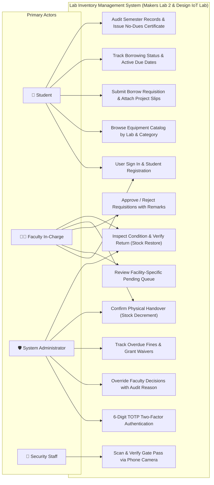
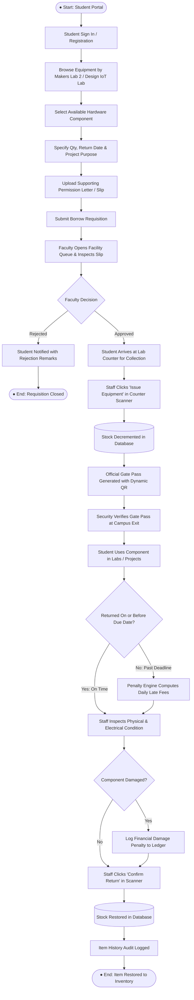
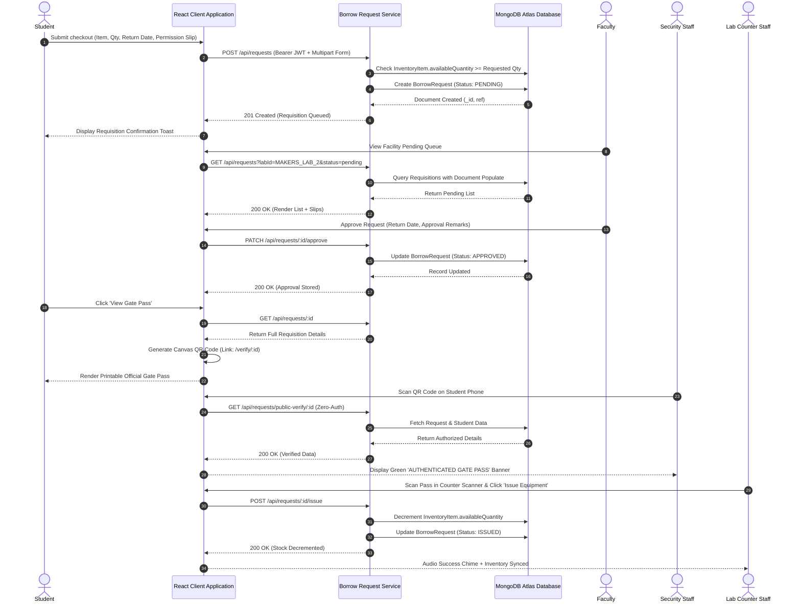
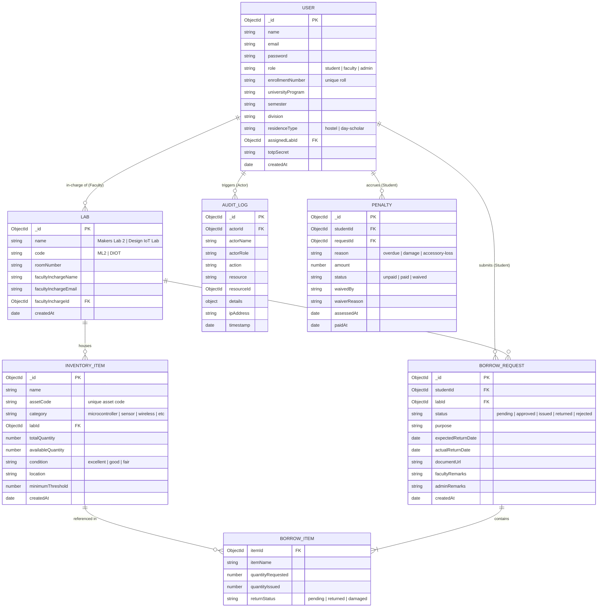
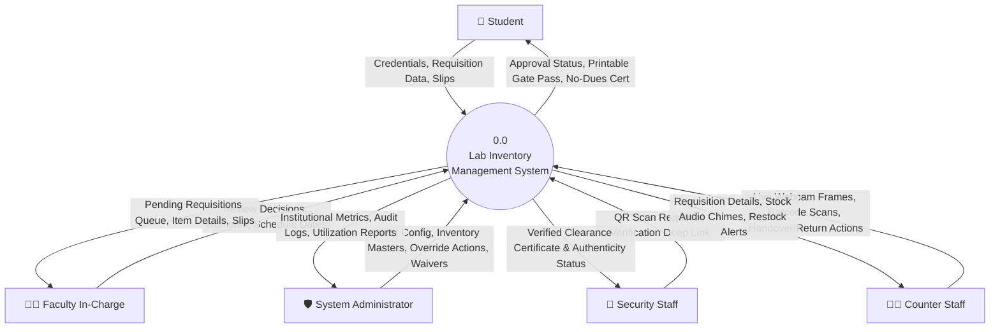
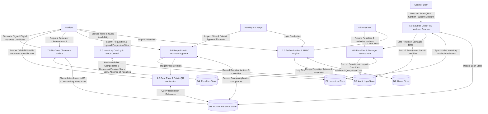

# LAB INVENTORY MANAGEMENT SYSTEM
## Hardware Clearance, Requisition & Gate Pass Management System
### A Project Report & Software Requirements Specification (SRS)

**Submitted In partial fulfillment of the requirement for the award of the Degree of**  
**Bachelor of Technology in Computer Science and Engineering (Software Engineering)**

---

### Institutional Credentials
**GSFC UNIVERSITY**  
*EDUCATION RE-ENVISIONED*  
Vigyan Bhavan, P. O. Fertilizer Nagar, Vadodara – 391750, Gujarat, India  

**Faculty Mentor:** Ms. Yoothika Patel (Assistant Professor)  
**Submitted by:**  
- **Harsh Shah** (Enrollment No: `25BT04D251`)  
- **Maitrey Thanki**  

**Department:** School of Technology, Computer Science & Engineering, GSFC University  
**Academic Year:** 2026–2027 (5th Semester)  

---

## 1. Declaration

We, **Harsh Shah (25BT04D251)** and **Maitrey Thanki**, the undersigned, hereby declare that the project report entitled **"Lab Inventory Management System – Hardware Clearance, Requisition & Gate Pass Management System"** is our original work and has been carried out under the guidance of **Ms. Yoothika Patel**, faculty at **GSFC UNIVERSITY**. The report is being submitted in partial fulfillment of the requirements for the **B.Tech. in Computer Science and Engineering**.

**Signatures:**

___________________________  
**Harsh Shah (25BT04D251)**  

___________________________  
**Maitrey Thanki**  

---

## 2. Certificate

This is to certify that the report submitted along with the project entitled **"Lab Inventory Management System – Hardware Clearance, Requisition & Gate Pass Management System"** has been carried out by **Harsh Shah (25BT04D251)** and **Maitrey Thanki** under my guidance in partial fulfillment for the degree of **Bachelor of Technology in Computer Science and Engineering – 5th Semester of GSFC University, Vadodara** during the academic year 2026–27. The students have successfully completed the project activity under my guidance.

**Signature of Faculty Mentor:**

___________________________  
**Ms. Yoothika Patel**  
Assistant Professor, School of Technology  
GSFC University, Vadodara  

---

## 3. Acknowledgement

We would like to express our sincere gratitude to **Ms. Yoothika Patel**, for her valuable guidance, continuous support, and encouragement throughout the development of our Software Engineering project, **"Lab Inventory Management System – Hardware Clearance, Requisition & Gate Pass Management System"**.

Her guidance and suggestions have helped us understand the various concepts of Software Engineering and apply them effectively in the planning, design, and development of our project. We are thankful for the time and effort she dedicated to guiding us and helping us improve our work.

We would also like to express our gratitude to our institution, **GSFC University**, for providing us with the opportunity and learning environment to undertake this project. The development of the Lab Inventory Management System has enabled us to gain practical knowledge of modern software engineering, system architecture, database design, and full-stack web application technologies.

Finally, we thank everyone who directly or indirectly supported us in completing this project successfully. This project has been a valuable learning experience, helping us enhance our technical knowledge, problem-solving abilities, and teamwork skills.

---

## 4. Abstract

**Lab Inventory Management System** is a web-based enterprise application designed to centralize and streamline the management of university engineering laboratories operating across multiple physical facilities, including **Makers Lab 2** and the **Design IoT Laboratory**. Managing laboratory hardware components, sensitive sensors, microcontroller development boards, and measuring equipment through manual paper slips, registers, or disconnected spreadsheets leads to equipment loss, inventory shortages, untracked overdue returns, inefficient student clearance, and lack of real-time auditability. The Lab Inventory Management System addresses these challenges by integrating complete laboratory requisition, hardware tracking, clearance, and security gate pass operations into a unified digital platform.

The system incorporates multiple interconnected modules, including authentication and role-based access control (RBAC), multi-lab facility management, real-time inventory catalog tracking, student borrow requisition workflows, digital document verification, single-page printable equipment gate passes with embedded QR verification, public zero-auth security verification portals, high-speed 30fps counter webcam check-in/out scanning, automated late penalty engines, damage assessment ledgers, digital no-dues clearance certification, and administrative audit logging. It supports distinct categories of users, including **Students**, **Faculty Lab In-Charges**, **Laboratory Assistants**, and **System Administrators**, ensuring each user interacts strictly with authorized capabilities.

The application is engineered on the modern **MERN stack**, comprising **MongoDB Atlas**, **Express.js**, **React 18 (Vite)**, and **Node.js**. React provides a responsive interface styled with custom CSS tokens, while Node.js and Express handle secure RESTful microservices. MongoDB, managed through Mongoose schemas, maintains consistent transactional records of assets, borrowings, approvals, and penalties. Time-Based One-Time Password (TOTP) two-factor authentication secures administrative consoles, while client-side canvas decoding with `jsQR` ensures seamless QR gate pass scanning across all devices.

The system replaces vulnerable manual paper slips with tamper-resistant digital gate passes and automated return compliance tracking, providing complete institutional visibility and operational excellence.

**Keywords:** Lab Inventory Management, MERN Stack, Role-Based Access Control, Digital Gate Pass, QR Code Verification, No-Dues Clearance, Equipment Requisition, Audit Logging, TOTP Two-Factor Authentication.

---

## 5. List of Figures

| Sr. No. | Title | Pg. No. in Report |
| :---: | :--- | :---: |
| 1 | **Figure 1: Use Case Diagram** | 34 |
| 2 | **Figure 2: Activity Diagram** | 35 |
| 3 | **Figure 3: Sequence Diagram** | 36 |
| 4 | **Figure 4: E-R Diagram** | 37 |
| 5 | **Figure 5: DFD Level – 0** **Figure 6: DFD Level - 1** | 38 |
| 6 | **Figure 7: Login Page Student & Faculty Login** | 39 |
| 7 | **Figure 8: Login Page Admin Authenticator Login (TOTP 2FA)** | 39 |
| 8 | **Figure 9: Inventory Catalog Page (Real-Time Stock & Category Filters)** | 40 |
| 9 | **Figure 10: Component Checkout Requisition Modal (Document Upload)** | 40 |
| 10 | **Figure 11.1: Student Dashboard - Requisition History Page** **Figure 11.2: Student Dashboard - Digital No-Dues Certificate Modal** | 41 42 |
| 11 | **Figure 12.1: Faculty Dashboard - Pending Approvals Page** **Figure 12.2: Faculty Dashboard - Handover Confirmation Form** | 43 44 |
| 12 | **Figure 13.1: Admin Dashboard - Overview Page (Metrics & Analytics)** **Figure 13.2: Admin Dashboard - Inventory Master Management** | 45 46 |
| 13 | **Figure 13.3: Admin Dashboard - Labs Management Page** **Figure 13.4: Admin Dashboard - User Administration Page** | 47 48 |
| 14 | **Figure 13.5: Admin Dashboard - Audit Logs & Overrides Page** | 49 |
| 15 | **Figure 14: Requests & Clearance Page with Multi-Status Filtering** | 50 |
| 16 | **Figure 15: Laboratory Equipment Gate Pass Modal with Dynamic QR** | 51 |
| 17 | **Figure 16: Public Gate Pass Zero-Auth Verification Portal (`/verify/:id`)** | 52 |
| 18 | **Figure 17: Lab Counter Quick Check-In / Check-Out Scanner Modal** **Figure 18: Lab Counter Scanner - 1-Click Handover & Return Form** | 53 54 |
| 19 | **Figure 19: Penalties & Damage Assessment Ledger Page** | 55 |
| 20 | **Figure 20: CSV Export Confirmation & Reporting** | 56 |

---

## 6. Table of Content

| Sr. No. | Title | Pg. No. |
| :---: | :--- | :---: |
| 1. | Title Page | 0 |
| 2. | Declaration | 1 |
| 3. | Certificate | 2 |
| 4. | Acknowledgement | 3 |
| 5. | Abstract | 4 |
| 6. | List of Figures | 5 |
| 7. | Table of Content | 8 |
| 8. | **Chapter 1: Introduction to Project** | 9 |
| | i. Overview & Detailed Module Descriptions | 9 |
| | ii. Project Objectives | 18 |
| | iii. Scope of the Project (Time & Performance Constraints) | 20 |
| 9. | **Chapter 2: System Analysis and Design** | 23 |
| | i. Disadvantages of Traditional Process | 23 |
| | ii. Proposed System & Benefits | 24 |
| | iii. Requirements Gathering Methods | 26 |
| | iv. Functional Requirements (FR-01 to FR-23) | 28 |
| | v. Non-Functional Requirements | 33 |
| | vi. UML & Architectural Diagrams (Figures 1 to 6) | 34 |
| 10. | **Chapter 3: Implementation of Project** | 39 |
| | Visual Walkthrough & Implementation Analysis (Figures 7 to 20) | 39 |
| 11. | **Chapter 4: Observations** | 58 |
| | i. Problems Encountered | 58 |
| | ii. Lessons Learned | 59 |
| 12. | **Chapter 5: Conclusion & Future Enhancement** | 60 |
| | i. Conclusion | 60 |
| | ii. Future Enhancement | 61 |

---

# Chapter 1: Introduction to Project

## i. Overview

**Lab Inventory Management System** is an enterprise-grade web application engineered to digitize, centralize, and automate hardware component tracking, borrowing workflows, and equipment clearance across university laboratories. Designed specifically for university engineering departments maintaining specialized facilities—such as **Makers Lab 2** and the **Design IoT Lab**—the platform eliminates manual paper logbooks, paper approval slips, untracked component loans, and administrative clearance bottlenecks.

In traditional university laboratories, student component requisitions are managed through physical binders and paper request slips. Students search for parts blindly without real-time inventory visibility, track down faculty across campus for manual pen-and-paper signatures, and sign handwritten paper registers at the counter. When borrowing periods end, unmonitored hardware stays in student lockers for weeks or months past project deadlines, causing severe component shortages for peer researchers and uncollected institutional penalties. Furthermore, during end-of-semester graduation clearance, students must physically walk between disparate laboratories to obtain manual ink stamps on paper "No-Dues" slips.

The **Lab Inventory Management System** provides a unified, role-based platform that enforces accountability from initial cataloging to final clearance. The system supports four distinct roles:
1. **Students**: Browse hardware items across labs, check real-time availability, add components to a requisition cart, specify academic purpose, upload supporting permission letters, track borrowing statuses, view/print official Equipment Gate Passes, and generate instant Digital No-Dues Certificates.
2. **Faculty In-Charges**: Review facility-specific pending applications, inspect uploaded project documents, approve/reject requisitions with feedback remarks, monitor return deadlines, and confirm physical handover.
3. **Lab Staff / Counter Assistants**: Operate high-speed 30fps webcam scanners to execute 1-click physical handovers and returns, record hardware condition (Good vs Damaged), and log repair charges.
4. **System Administrators**: Manage multi-lab facilities, provision user accounts, oversee inventory masters, audit administrative overrides, evaluate lab utilization metrics, and grant fee waivers.

### Detailed Core Modules

#### 1. Authentication and Authorization Module
Manages identity verification and enforces granular access control across all endpoints:
- User login and credential verification using email and password.
- Secure password hashing using salted `bcrypt` algorithms.
- Time-Based One-Time Password (TOTP) two-factor authentication for administrative accounts.
- Stateless JSON Web Token (JWT) session generation and validation.
- Role-Based Access Control (RBAC) across Student, Faculty, and Admin personas.
- Protected frontend client routes and backend API route middleware guards.
- Automatic token expiration handling, stale session purging, and unauthorized redirection.

#### 2. User and Role Management Module
Allows administrators to manage institutional accounts and academic credentials:
- Create, update, activate, and deactivate student, faculty, and administrator accounts.
- Configure student enrollment roll numbers (e.g., `25BT04D251`), program, semester, division, and residence type.
- Associate faculty members with designated laboratory facilities.
- Maintain secure credential reset mechanisms and profile management.

#### 3. Laboratory Facility Management Module
Provides centralized administration of university laboratory facilities:
- Create and maintain laboratory facility records (e.g., Makers Lab 2, Design IoT Lab).
- Maintain room codes, physical building locations, and operational hours.
- Designate primary faculty in-charges and lab assistant contacts.
- Partition inventory ledgers and approval queues by facility to prevent cross-lab contamination.

#### 4. Inventory and Component Tracking Module
Maintains real-time stock balances and physical hardware parameters:
- Create, update, and categorize hardware items (Microcontrollers, Sensors, Wireless IoT, Measurement, Actuators).
- Track total physical quantity, available stock, and on-loan balances in real time.
- Assign asset codes, serial numbers, and equipment condition ratings.
- Enforce low-stock threshold alerts to trigger automated restocking warnings.
- Real-time stock decrementing upon item issuance and stock restoration upon return.

#### 5. Borrow Requisition and Checkout Workflow Module
Automates the equipment borrowing application lifecycle:
- Interactive catalog cart enabling multi-item selection with requested quantities.
- Specify academic project purpose, coursework details, and scheduled return dates.
- Upload digital faculty recommendation letters, permission slips, or project sanction files.
- Track requisition lifecycles through defined states: `Pending` → `Approved` → `Issued` → `Returned` (or `Rejected`).
- Facility-filtered faculty queues providing 1-click approvals and rejection remarks.

#### 6. Laboratory Equipment Gate Pass & Clearance Module
Generates tamper-resistant, official institutional gate passes:
- Automatically generated upon faculty approval of a borrow requisition.
- Formatted with official GSFC University institutional header, seal, and ref `#GP-XXXX`.
- Detailed student profile (Name, Roll No, Program, Semester, Division, Residence Type).
- Authorized equipment inventory table with serials, quantities, and return deadlines.
- Institutional laboratory policy terms and liability notices.
- Single-page `@media print` CSS layout for clean PDF printing and physical clearance slips.

#### 7. Public Zero-Auth Verification Portal Module
Enables seamless mobile camera verification for campus security personnel:
- Standalone public verification route (`/verify/:id` and `/pass/:id`).
- Zero authentication requirement, allowing security guards to authenticate passes without login.
- Displays live cryptographic authenticity banner, institutional seal, and verification timestamps.
- Verifies authorized items, return due dates, student credentials, and faculty endorsements.
- Provides authenticated staff with a 1-click shortcut to open the requisition in the counter scanner.

#### 8. Counter Quick Check-In / Check-Out Scanner Module
Empowers counter assistants to process handovers and returns in under 3 seconds:
- Real-time 30fps webcam viewfinder decoding QR codes via pure client-side `jsQR`.
- Image file uploader allowing drag-and-drop decoding of gate pass screenshots and photos.
- Universal lookup accepting Pass Ref (`#GP-XXXX`), ObjectIds, or Student Roll Numbers.
- 1-click "Issue Equipment" action that instantly decrements physical stock.
- 1-click "Accept Return" action that verifies return punctuality and restocks inventory.
- Audio scan chime using the browser Web Audio API confirming scan success or warnings.

#### 9. Damage Assessment & Penalty Ledger Module
Enforces hardware preservation and financial accountability:
- Inspect hardware physical and electrical condition upon counter return (Good vs Damaged).
- Log financial damage liabilities and repair charges directly to student accounts.
- Automated background cron jobs computing daily overdue late fees for unreturned hardware.
- Administrative penalty ledger supporting search, status filtering, and fee waiver authorizations.

#### 10. Digital No-Dues Clearance Certification Module
Automates semester-end institutional clearance audits:
- Automated real-time audit across all active borrowings, unreturned items, and outstanding fines.
- Evaluates whether a student is completely free of academic lab liabilities across all university facilities.
- Generates an official printable Digital No-Dues Certificate with GSFC University seal and QR code.
- Eliminates multi-day physical campus clearance walks for graduating students.

#### 11. Audit Logging and System Analytics Module
Ensures complete operational transparency and data-driven management:
- Immutable audit log capturing all administrative overrides, role changes, and inventory edits.
- Captures actor identity, action type, affected resource, IP address, and exact timestamp.
- Departmental analytics tracking lab utilization rates, peak borrowing periods, and equipment failure frequencies.
- One-click CSV export of all requisition, inventory, and penalty ledgers for institutional reporting.

---

## ii. Project Objective

The primary objective of the Lab Inventory Management System is to design, develop, and deploy an enterprise-grade digital platform that eliminates paper-based laboratory tracking, automates equipment clearances, and ensures absolute institutional accountability for hardware assets.

The specific objectives are:
1. **Centralized Laboratory Management**: Maintain a unified digital platform managing hardware inventory across multiple university facilities (Makers Lab 2 and Design IoT Lab).
2. **Secure Role-Based Access Control**: Enforce strict authorization boundaries separating Student, Faculty, Lab Assistant, and Administrator workspaces.
3. **Two-Factor Authentication**: Integrate Time-Based One-Time Password (TOTP) security for privileged administrative operations.
4. **Real-Time Inventory Control**: Maintain dynamic stock balances that decrement automatically upon issue and restore upon return.
5. **Automated Requisition Workflows**: Streamline borrowing requests, coursework endorsements, and faculty approval lifecycles.
6. **Digital Document Verification**: Support uploading and verifying faculty permission letters and project sanction slips during checkout.
7. **Institutional Gate Pass Issuance**: Auto-generate official printable equipment gate passes with GSFC University seals and security terms.
8. **Universal QR Code Clearance**: Embed dynamic cryptographic QR codes into gate passes readable by mobile cameras and barcode scanners.
9. **Zero-Auth Public Verification**: Provide a public `/verify/:id` portal allowing campus security guards to authenticate gate passes without login credentials.
10. **Rapid Counter Check-In / Check-Out**: Implement real-time 30fps webcam scanning and 1-click physical handover/return confirmation.
11. **Automated Late Penalty Calculation**: Programmatically compute daily overdue fines and damage assessment liabilities.
12. **Digital No-Dues Clearance**: Automate semester-end institutional clearance audits and issue cryptographic clearance certificates.
13. **Administrative Audit Trails**: Maintain tamper-proof audit logs recording all administrative overrides and sensitive actions.
14. **Maintainable MERN Architecture**: Build a clean, modular full-stack codebase with reusable components and organized REST services.
15. **Responsive User Interface**: Provide a premium, accessible UI supporting desktop, laptop, tablet, and smartphone viewports.

---

## iii. Scope of the Project

The scope encompasses the design, full-stack implementation, testing, and deployment of a multi-facility laboratory inventory and clearance platform for GSFC University.

### Addressing the Time Constraints
Developing an enterprise platform within academic deadlines required structured development practices:
- **Modular Development**: Partitioning the application into independent, decoupled micro-modules (Auth, Inventory, Requests, Gate Pass, Scanner, Penalties, Clearance).
- **Prioritization of Core Workflows**: Focusing first on requisition lifecycles, stock state transitions, and gate pass generation before secondary reporting.
- **Reusable Component Architecture**: Developing unified design tokens, modal wrappers, metric cards, and responsive tables to accelerate frontend implementation.
- **Unified MERN Stack**: Leveraging JavaScript across client and server (React Vite, Node.js, Express, Mongoose) to eliminate cross-language friction.
- **Standardized RESTful APIs**: Implementing predictable API endpoints with structured JSON responses for parallel frontend and backend development.
- **Incremental Integration Testing**: Conducting continuous functional and authorization tests during development rather than postponing testing to the final phase.

### Addressing the Performance Constraint
The platform maintains sub-second response times and smooth 60fps rendering even under heavy concurrency:
- **Optimized Database Indexing**: Creating compound MongoDB indexes on frequently queried fields, including user email, asset codes, lab IDs, and request statuses.
- **Projection Queries**: Limiting retrieved database fields strictly to attributes required by active views, avoiding heavy over-fetching.
- **Offscreen Canvas QR Processing**: Decoding video frames using optimized HTML5 canvas pixel extraction with `jsQR`, minimizing main-thread CPU overhead.
- **Client-Side State Caching**: Utilizing React state and URL search parameters to minimize redundant network round-trips.
- **Controlled Data Retrieval**: Requesting pre-aggregated summary counts for dashboards rather than querying full database collections.
- **Lightweight Responsive Styling**: Utilizing zero-runtime Vanilla CSS tokens instead of bloated utility frameworks, ensuring fast initial page loads.

### Overall Project Scope
The completed application encompasses the following verified capabilities:
- Management of multiple university laboratory facilities and departmental equipment stocks.
- Multi-role authentication with TOTP two-factor security for system administrators.
- Real-time component catalog with category filtering, search, and condition tracking.
- Requisition submission with multi-item selection and permission slip file uploads.
- Facility-specific faculty review queues with approval remarks and return scheduling.
- Automatic inventory stock decrementing upon issue and stock restoration upon return.
- Single-page printable Equipment Gate Passes with GSFC University institutional branding.
- Public zero-auth Gate Pass verification portal accessible from mobile phone cameras.
- Real-time webcam Counter Scanner with animated laser reticle, image upload, and 1-click actions.
- Penalty and damage assessment ledger with administrative waiver authorizations.
- Automated Digital No-Dues Clearance audit and cryptographic certificate generation.
- System audit logging with mandatory override justifications and CSV report exports.

---

# Chapter 2: System Analysis and Design

## i. Disadvantages of Traditional Process

Traditional university laboratory management relies on manual paper registers, physical logbooks, printed requisition slips, and email exchanges. These traditional processes present severe limitations:
- **Manual Record Maintenance**: Handwritten logbooks suffer from illegible handwriting, physical wear-and-tear, page loss, and accidental destruction.
- **Lack of Centralized Management**: Different labs maintain isolated physical binders, making campus-wide inventory visibility completely impossible.
- **Inefficient Equipment Stock Tracking**: Faculty cannot verify real-time component availability, leading to redundant purchases or unfulfilled student projects.
- **Delayed Approvals & Administrative Bottlenecks**: Students must physically track down faculty members across campus to obtain manual signatures on paper slips.
- **Unmonitored Overdue Borrowings**: Without automated notifications, students frequently retain lab hardware for months past project deadlines without consequence.
- **Difficult Penalty & Damage Tracking**: Late return fines and hardware damage liabilities are tracked informally on paper, resulting in uncollected university fees.
- **Vulnerable Gate Pass Clearances**: Paper gate passes are easily forged, manipulated, or lost, creating significant campus security and asset theft risks.
- **Cumbersome Semester No-Dues Clearance**: Students spend days walking to every individual lab to obtain physical ink stamps for graduation clearance.
- **Absence of Audit Trails**: Manual logbooks provide zero accountability when administrative overrides, unauthorized issuances, or missing items occur.
- **Lack of Operational Analytics**: Department heads lack data on equipment failure rates, lab utilization patterns, and high-demand components.

---

## ii. Proposed System & Benefits

The **Lab Inventory Management System** establishes an integrated digital pipeline connecting students, faculty, lab assistants, administrators, and campus security staff.

### Operational Benefits
1. **Centralized Information Management**: Complete campus-wide inventory visibility across all labs in a single unified database.
2. **Substantial Reduction in Administrative Burden**: Eliminates manual logbook entry and reduces faculty approval turnaround from days to minutes.
3. **Total Asset Accountability**: Every component is tracked from initial cataloging to physical handover and return inspection.
4. **Elimination of Paper Slips**: Tamper-proof digital gate passes with QR verification prevent document forgery and loss.
5. **Zero-Barrier Security Verification**: Campus security guards can authenticate passes instantly on mobile devices with zero login friction.
6. **High-Speed Counter Operations**: Real-time webcam scanning enables 1-click handovers and returns in under 3 seconds.
7. **Automated Late Fee Enforcement**: Eliminates lost institutional revenue by calculating daily overdue fines programmatically.
8. **Instant No-Dues Clearance**: Replaces multi-day physical campus clearance walks with instant digital certification.
9. **Tamper-Proof Audit Logging**: Enforces mandatory justifications on administrative overrides, guaranteeing administrative transparency.
10. **Data-Driven Procurement Planning**: Analytics dashboards highlight high-demand items, equipment failure rates, and lab utilization trends.
11. **Scalable Cloud Architecture**: Built on MongoDB Atlas and Node.js microservices ready for multi-campus expansion.

---

## iii. Requirements Gathering Methods

Requirements engineering was conducted through systematic analysis of university laboratory operations:
- **Stakeholder Identification**: Identified distinct user groups (Students, Faculty In-Charges, Lab Assistants, System Administrators, Security Staff) and mapped their core responsibilities.
- **Study of Existing Processes**: Analyzed physical logbooks and paper approval slips at Makers Lab 2, identifying frequent handwriting errors, lost slips, and unrecorded return dates.
- **Use-Case Identification**: Formalized user interactions into structured use cases defining boundaries between actors and system microservices.
- **Functional Decomposition**: Decomposed the architecture into discrete subsystems (Authentication, Inventory, Requisitions, Gate Pass, Scanner, Penalties, Clearance, Audit).
- **Validation of Requirements**: Verified requirements against institutional laboratory safety policies, electrostatic discharge handling guidelines, and academic clearance statutes.

---

## iv. Functional Requirements

- **FR-01 (Authentication)**: The system shall authenticate users securely using email and password with salted bcrypt verification.
- **FR-02 (2FA Security)**: The system shall require a valid 6-digit TOTP authenticator token for administrative login access.
- **FR-03 (Role Authorization)**: The system shall enforce Role-Based Access Control restricting routes and APIs based on user personas.
- **FR-04 (User Management)**: The system shall allow administrators to create, update, activate, and deactivate student and faculty accounts.
- **FR-05 (Facility Configuration)**: The system shall support multi-lab facility management and associate faculty in-charges with specific labs.
- **FR-06 (Inventory Catalog)**: The system shall maintain hardware items with asset codes, categories, total stock, and available stock.
- **FR-07 (Stock Availability)**: The system shall automatically compute available quantities and prevent checkout when stock is zero.
- **FR-08 (Checkout Requisition)**: The system shall allow students to select components, quantities, return deadlines, and project purpose.
- **FR-09 (Document Upload)**: The system shall support uploading faculty permission letters and project sanction documents (PDF/PNG/JPEG).
- **FR-10 (Review Queue)**: The system shall provide faculty with facility-filtered queues showing pending borrow requests and uploaded files.
- **FR-11 (Decision Processing)**: The system shall allow faculty to approve or reject requisitions with mandatory feedback remarks.
- **FR-12 (Physical Handover)**: The system shall confirm hardware handover and automatically decrement inventory stock in the database.
- **FR-13 (Gate Pass Generation)**: The system shall generate official single-page printable Equipment Gate Passes upon approval.
- **FR-14 (QR Code Clearance)**: The system shall embed dynamic QR codes into gate passes encoding verified public deep links.
- **FR-15 (Public Verification)**: The system shall provide a public `/verify/:id` route showing verified clearance data without login barriers.
- **FR-16 (Counter Scanner)**: The system shall support real-time 30fps webcam QR decoding via jsQR on an offscreen canvas.
- **FR-17 (Image QR Decode)**: The system shall allow uploading screenshots or photos of QR codes to decode requisitions instantly.
- **FR-18 (Instant Handover/Return)**: The system shall provide 1-click handover and return confirmation buttons in the counter scanner.
- **FR-19 (Condition & Damage Logging)**: The system shall allow staff to record item condition (Good vs Damaged) and log financial repair penalties.
- **FR-20 (Overdue Fine Calculation)**: The system shall compute automated daily late fines for borrowings retained past the approved due date.
- **FR-21 (Penalty Management)**: The system shall provide an administrative ledger to track unpaid fines and record authorized fee waivers.
- **FR-22 (No-Dues Audit)**: The system shall automatically audit student records across all labs and issue cryptographic No-Dues Certificates.
- **FR-23 (Audit Logging)**: The system shall maintain immutable audit logs for all administrative overrides, capturing actor, action, and timestamp.

---

## v. Non-Functional Requirements

- **Security**: Passwords hashed with bcrypt (salt rounds = 10); JWT tokens signed with secure keys; TOTP 2FA; sanitized input validation.
- **Performance**: API response times under 200ms; client page rendering under 500ms; webcam scanning at 30 frames per second.
- **Reliability**: Transactional stock consistency; automatic Mongoose schema validation; graceful error recovery with user-friendly alerts.
- **Usability**: Clean, intuitive UI with responsive navigation, status badges, audio scan chimes, and single-click quick actions.
- **Maintainability**: Modular MERN codebase with separation of concerns between controllers, routes, models, components, and hooks.
- **Scalability**: Stateless backend microservices supporting horizontal scaling and MongoDB Atlas cloud clustering.
- **Availability**: Designed for 99.9% uptime during university operating hours with automated health check endpoints.
- **Data Integrity**: Referential integrity across borrowings, users, labs, and penalties with atomic database updates.
- **Portability & Responsiveness**: Fully functional across Google Chrome, Mozilla Firefox, Apple Safari, Microsoft Edge, and mobile viewports.
- **Compatibility & Integration**: Standard JSON REST APIs allowing integration with university ERP and student registry systems.
- **Testability**: Structured unit, integration, and end-to-end browser test suites verifying all critical user journeys.
- **Data Privacy**: Role-based data masking ensuring students only view their own records and personal student data is shielded.

---

## vi. UML & Architectural Diagrams

### 1. Figure 1: Use Case Diagram
Describes interactions between external actors (Students, Faculty In-Charge, Lab Assistants, System Administrators, Security Staff) and core system services.

---

### 2. Figure 2: Activity Diagram
Models the complete operational workflow from initial component checkout, faculty approval, physical counter handover, active loan use, condition inspection, to stock restoration and penalty calculation.

---

### 3. Figure 3: Sequence Diagram
Illustrates chronological message interactions exchanged between Student, React Frontend, Express API, MongoDB Atlas, Lab Staff, and Security Personnel during equipment requisition, clearance, and return.

---

### 4. Figure 4: Entity-Relationship (E-R) Diagram
Visualizes the database schema design across MongoDB collections, primary identifiers, fields, and referential associations.

---

### 5. Figure 5: Data Flow Diagram Level – 0 (Context Level)
Defines the highest abstraction boundary of the system, depicting external entities and primary information flows.

---

### 6. Figure 6: Data Flow Diagram Level – 1 (Functional Decomposition)
Decomposes Level-0 into primary operational sub-processes and persistent database stores.

---

# Chapter 3: Implementation of Project

This chapter presents the practical realization and visual interface implementation of the Lab Inventory Management System. The user interface was developed with responsive Vanilla CSS and React, following modern design guidelines with rich institutional aesthetics, accessible typography, status badges, and interactive feedback.

### Figure 7: Login Page Student & Faculty Login
- **Route**: `/login`
- **Description**: Features role switching tabs between Student and Faculty personas. Users authenticate using university email and password. Built with custom CSS form styling, loading state indicators, and responsive layouts.

### Figure 8: Login Page Admin Authenticator Login (TOTP 2FA)
- **Route**: `/admin-login`
- **Description**: Displays the administrative portal requiring Time-Based One-Time Password (TOTP) two-factor authentication. Administrators enter their authorized email alongside a live 6-digit rolling code generated from their mobile authenticator app.

### Figure 9: Inventory Catalog Page (Real-Time Stock & Category Filters)
- **Route**: `/inventory`
- **Description**: The hardware catalog displays equipment across university facilities (Makers Lab 2 and Design IoT Lab). Components are organized by technical category with live available stock counts, asset codes, and condition badges.

### Figure 10: Component Checkout Requisition Modal (Document Upload)
- **Component**: `CheckoutModal.jsx`
- **Description**: Presents the borrow requisition modal. Students select quantity, project purpose, expected return deadline, and attach supporting permission letters or project sanction documents via drag-and-drop file upload.

### Figure 11.1: Student Dashboard - Requisition History Page
- **Route**: `/student`
- **Description**: Displays metric cards summarizing active loans, approved items, due soon warnings, and outstanding penalties. The borrowing history list provides instant access to printable Gate Passes.

### Figure 11.2: Student Dashboard - Digital No-Dues Certificate Modal
- **Component**: `NoDuesCertificateModal.jsx`
- **Description**: Automated institutional clearance modal. Evaluates borrowing histories across all labs in real time and issues an official certificate with GSFC University branding and verification QR code.

### Figure 12.1: Faculty Dashboard - Pending Approvals Page
- **Route**: `/faculty`
- **Description**: Facility-filtered approval queue. Faculty in-charges inspect student details, coursework purpose, and attached permission files, approving or rejecting requisitions with contextual feedback remarks.

### Figure 12.2: Faculty Dashboard - Handover Confirmation Form
- **Route**: `/faculty`
- **Description**: Active loan monitoring and physical handover confirmation. Faculty confirm component collection, automatically decrementing available stock and establishing loan accountability.

### Figure 13.1: Admin Dashboard - Overview Page (Metrics & Analytics)
- **Route**: `/admin` (Overview Tab)
- **Description**: Executive dashboard featuring campus-wide hardware utilization metrics, total borrowings, active penalty counts, and facility distribution statistics.

### Figure 13.2: Admin Dashboard - Inventory Master Management
- **Route**: `/admin` (Inventory Tab)
- **Description**: Inventory master management. Administrators add new hardware components, edit stock quantities, assign asset codes, and manage laboratory component allocations.

### Figure 13.3: Admin Dashboard - Labs Management Page
- **Route**: `/admin` (Labs Tab)
- **Description**: Laboratory facility administration. Admins configure laboratory names, facility locations, room numbers, and assign faculty in-charges for Makers Lab 2 and Design IoT Lab.

### Figure 13.4: Admin Dashboard - User Administration Page
- **Route**: `/admin` (Users Tab)
- **Description**: User administration and role management. Administrators review user accounts, modify role permissions, update student roll numbers, and enforce account activations.

### Figure 13.5: Admin Dashboard - Audit Logs & Overrides Page
- **Route**: `/admin` (Audit Tab)
- **Description**: Immutable system audit log. Every administrative override, role adjustment, and stock modification is logged with actor details, action types, and exact timestamps.

### Figure 14: Requests & Clearance Page with Multi-Status Filtering
- **Route**: `/requests`
- **Description**: Borrow Requests & Clearance page. Users filter requisitions across status tabs (All, Pending, Approved, Issued, Returned, Overdue, Rejected), search by reference ID, and print gate passes.

### Figure 15: Laboratory Equipment Gate Pass Modal with Dynamic QR
- **Component**: `GatePassModal.jsx`
- **Description**: Official Laboratory Equipment Gate Pass modal. Featuring the GSFC University seal, student identification, authorized equipment inventory table, institutional liability disclaimer, and dynamic verification QR code.

### Figure 16: Public Gate Pass Zero-Auth Verification Portal (`/verify/:id`)
- **Route**: `/verify/:id`
- **Description**: Standalone public verification portal. Designed for smartphone camera scanning, security guards authenticate gate passes instantly without requiring application login.

### Figure 17: Lab Counter Quick Check-In / Check-Out Scanner Modal
- **Component**: `CounterScannerModal.jsx`
- **Description**: Counter Scanner modal featuring live 30fps webcam scanning, animated laser reticles, image upload QR decoding, and instant sample requisition test chips.

### Figure 18: Lab Counter Scanner - 1-Click Handover & Return Form
- **Component**: `CounterScannerModal.jsx`
- **Description**: Instant requisition lookup. Counter staff execute 1-click physical handover or return acceptance with optional damage penalty assessment.

### Figure 19: Penalties & Damage Assessment Ledger Page
- **Route**: `/penalties`
- **Description**: Penalties & Damage Assessment Ledger. Late return fees and hardware repair liabilities are tracked with full payment status, student filters, and administrative waiver actions.

### Figure 20: CSV Export Confirmation & Reporting
- **Component**: `exportCsv.js`
- **Description**: CSV export reporting. All requisition records, borrowing timelines, and approval notes are exported into standard CSV spreadsheets for academic reporting.

---

# Chapter 4: Observations

## i. Problems Encountered

During the analysis, architectural design, and full-stack development of the Lab Inventory Management System, several technical and structural challenges arose due to the integration of complex hardware borrowing lifecycles into a unified web application:
1. **Role-Based Access Control & Route Guarding**: Managing three distinct user personas (Student, Faculty, Admin) and preventing unauthorized API access required robust server middleware and reactive client route wrappers.
2. **Database Schema Design & State Integrity**: Modeling complex document relationships between users, facilities, inventory items, and borrow requests while ensuring inventory available quantities never become negative.
3. **Universal Webcam QR Decoding**: Browser-native `BarcodeDetector` APIs are unsupported by default on standard browsers; resolving this required implementing pure client-side canvas decoding via `jsQR`.
4. **Public Verification Security & Data Sanitization**: Enabling external security guards to verify gate passes without login required creating a zero-auth public endpoint that sanitizes sensitive user information.
5. **Strict Single-Page Print Layout Architecture**: Gate passes required precise `@media print` CSS rules to eliminate browser margins, hide navigation bars, and ensure crisp single-page PDF output.
6. **Time Management & Academic Scheduling**: Delivering 11 interconnected modules within academic deadlines necessitated prioritizing core requisition workflows before secondary analytics.
7. **Testing & Cross-Device Compatibility**: Validating webcam permissions, responsive flex layouts, and sound playback across desktop, laptop, and mobile devices.

---

## ii. Lessons Learned

The engineering of the Lab Inventory Management System provided extensive hands-on experience in applying professional software engineering methodologies to a real-world enterprise problem:
1. **Modular Full-Stack Development**: Gained deep expertise in architecting clean, maintainable systems using the MERN stack (MongoDB, Express.js, React, Node.js).
2. **State Machine Design**: Learned to model hardware borrowing lifecycles as strict state machines (Pending → Approved → Issued → Returned) with automated inventory synchronization.
3. **Client-Side Canvas Image Processing**: Understood how to capture video frames, manipulate imageData buffers, and decode QR codes at 30 frames per second using `jsQR`.
4. **API Security & Authorization**: Mastered JWT token generation, salted bcrypt password hashing, and role-based route middleware protection.
5. **Responsive UI & Accessibility**: Implemented responsive design tokens, accessible color contrasts, micro-animations, and audio feedback for optimal usability.
6. **Pair Programming & Version Control**: Developed rigorous Git branching habits (`main` and `pr1`), code reviews, and structured commit workflows.

---

# Chapter 5: Conclusion and Future Enhancement

## i. Conclusion

The **Lab Inventory Management System** successfully replaces antiquated paper logbooks and manual clearance slips with a modern, high-performance web enterprise application tailored to university engineering laboratories.

Developed on the MERN stack, the application centralizes hardware inventory across multiple university facilities (**Makers Lab 2** and **Design IoT Lab**), automates student borrowing workflows, enforces role-based approvals, and issues cryptographic QR-enabled Equipment Gate Passes. The inclusion of a zero-auth public verification portal empowers campus security personnel to verify clearances on smartphones in real time, while the 30fps webcam Counter Scanner reduces physical handovers and returns to single-click operations.

The project demonstrates the practical application of key software engineering disciplines, including requirements engineering, UML modeling, relational and document database design, RESTful API development, two-factor authentication security, and rigorous system validation. The resulting platform eliminates equipment loss, ensures complete operational accountability, and establishes a robust foundation for institutional laboratory management.

---

## ii. Future Enhancement

The system can be enhanced in subsequent development phases in the following ways:
1. **Physical RFID Hardware Integration**: Interfacing physical RFID readers at lab doorways to detect unissued hardware removal automatically.
2. **Automated SMS & WhatsApp Alerts**: Integrating university communication gateways to dispatch instant return reminders directly to student phones.
3. **IoT Smart Hardware Lockers**: Connecting with microcontroller-operated smart lockers enabling autonomous 24/7 hardware pickup and drop-off.
4. **AI-Based Demand Forecasting**: Utilizing machine learning algorithms on historical borrowing data to predict peak component demand and automate procurement.
5. **Native Mobile Application**: Developing native iOS and Android apps with push notifications and offline equipment inspection capabilities.
6. **Enterprise ERP Integration**: Connecting with university registrar databases for automatic student enrollment verification and academic fee holds.
