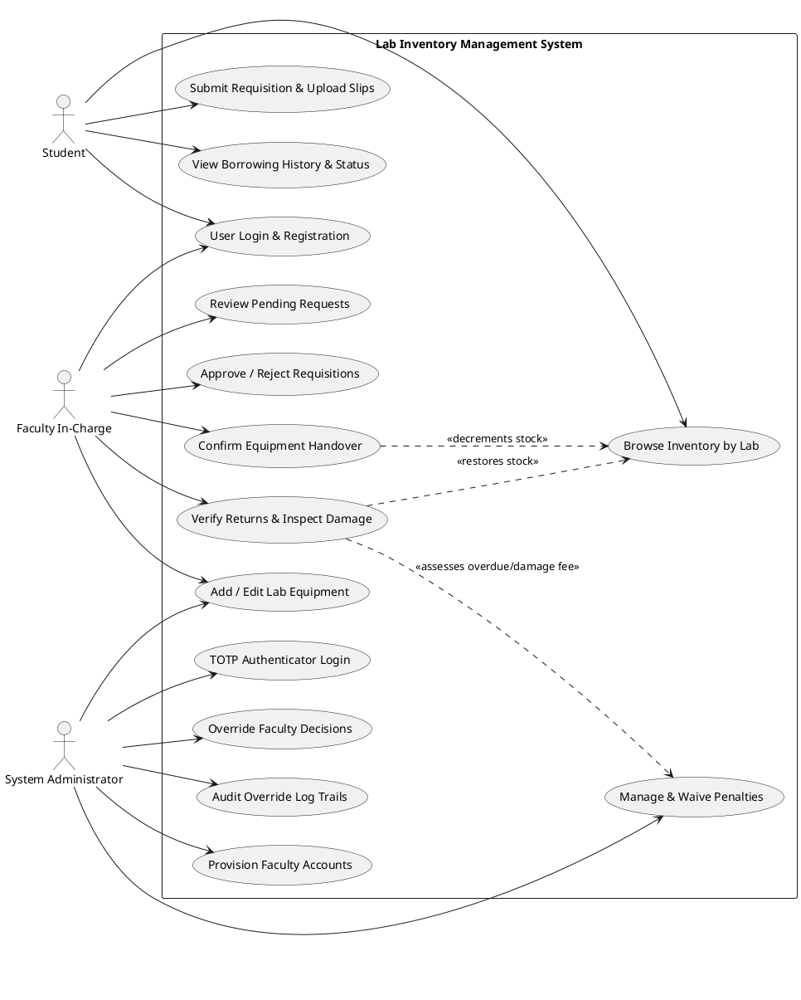
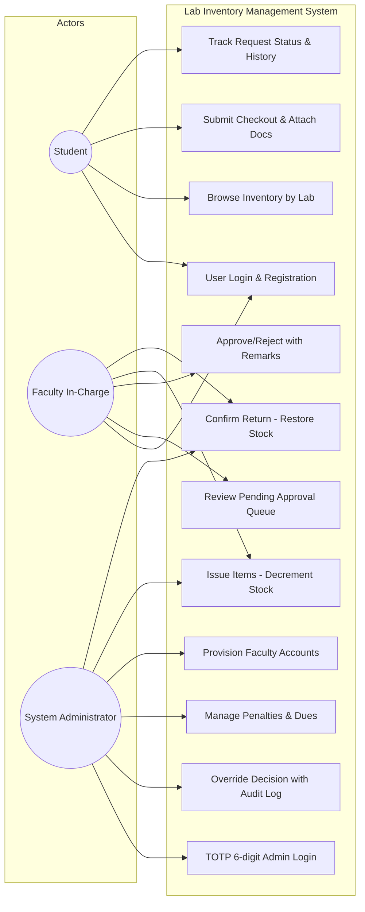
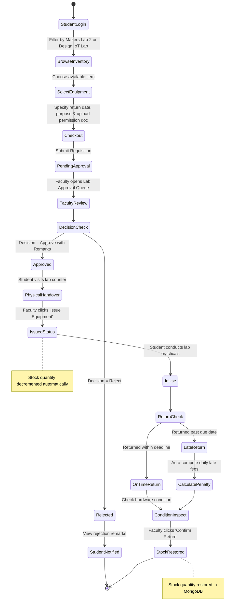
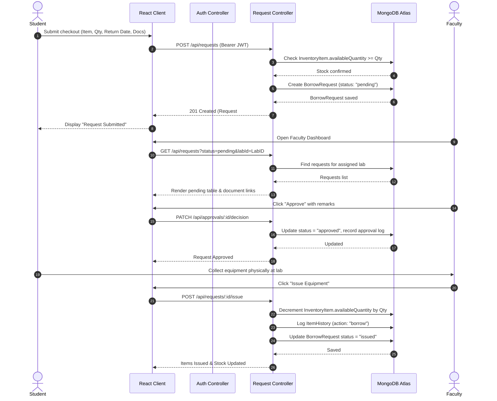
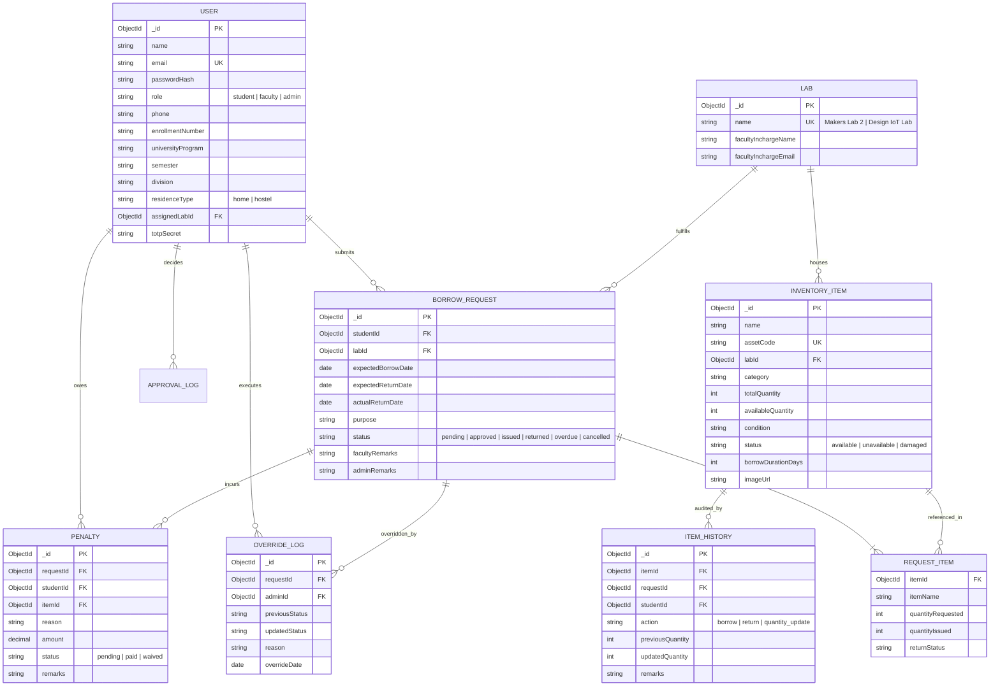
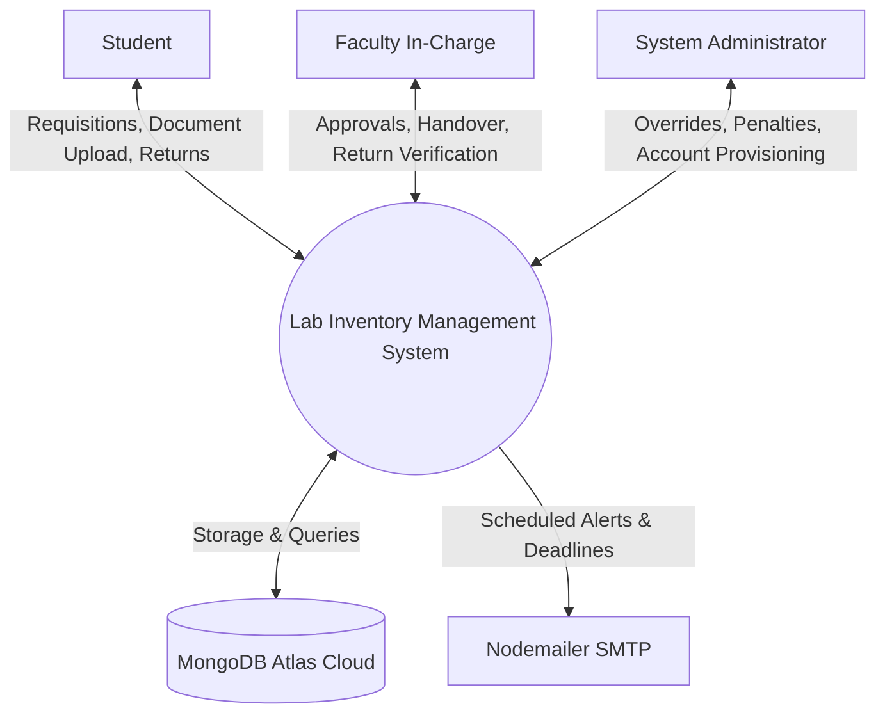
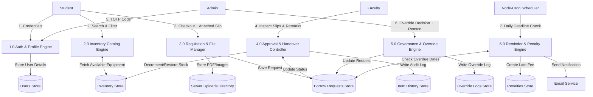

# Lab Inventory Management System
## Academic Project Report

**Submitted in partial fulfillment of the requirement for the award of the Degree of**  
**Bachelor of Technology in Computer Science and Engineering (Software Engineering)**  
**GSFC University, Vadodara**

---

### Project Metadata
* **Project Title**: Lab Inventory Management System (Makers Lab 2 & Design IoT Lab)
* **Faculty Mentor**: Ms. Yoothika Patel (Assistant Professor, School of Technology)
* **Submitted By**:
  * Harsh Shah (25BT04D251)
  * Maitrey Thanki
* **Institution**: School of Technology - Computer Science & Engineering, GSFC University, Vigyan Bhavan, P. O. Fertilizer Nagar, Vadodara - 391750, Gujarat, India
* **Date**: October - 2026

---

## Declaration
We, **Harsh Shah (25BT04D251)** and **Maitrey Thanki**, the undersigned, hereby declare that the project report entitled **"Lab Inventory Management System"** is our original work and has been carried out under the guidance of **Ms. Yoothika Patel**, faculty at **GSFC UNIVERSITY**. The report is being submitted in partial fulfillment of the requirements for the Bachelor of Technology in Computer Science and Engineering.

---

## Certificate
This is to certify that the report submitted along with the project entitled **"Lab Inventory Management System"** has been carried out by **Harsh Shah (25BT04D251)** and **Maitrey Thanki** under my guidance in partial fulfillment for the degree of Bachelor of Technology in Computer Science and Engineering – V Semester of GSFC University, Vadodara during the academic year 2026. The students have successfully completed the project activity under my guidance.

---

## Acknowledgement
We are extremely grateful and remain indebted to our honorable mentor and professor **Ms. Yoothika Patel** for being a continuous source of inspiration, guidance, and constructive support throughout the design, architecture, implementation, and evaluation of this project. Her valuable suggestions and feedback were critical in helping us successfully conceptualize and build the **Lab Inventory Management System**.

We also extend our sincere gratitude to the technical faculty in-charge of **Makers Lab 2** and **Design IoT Lab** for providing domain expertise, equipment data, and workflow requirements. Furthermore, we express our thanks to the administration and management of **GSFC University** for providing the lab facilities, computing infrastructure, and encouraging environment necessary to accomplish this project.

---

## Abstract
In typical academic institutions, engineering laboratories (such as Makers Lab 2 and Design IoT Lab) store and issue hundreds of valuable microcontrollers, sensors, computing boards, and measuring equipment. Traditionally, equipment borrowing, faculty approvals, and physical issuance are managed through manual paper slips and logbooks. This causes lack of real-time stock availability, prolonged approval delays, unmonitored overdue items, loss of permission slips, and heavy manual workload for lab in-charges.

This project delivers a centralized, automated web application designed to digitize the entire lab equipment borrowing lifecycle. It features role-based interfaces for Students, Faculty In-charge, and System Administrators. Students can browse live inventory by lab and category, submit borrow requests, and upload digital permission documents. Faculty members review applications, inspect uploaded slips, approve/reject requests, and confirm physical handover (decrementing stock) and returns (restoring stock). Administrators monitor all student records across both labs, override decisions with mandatory audit reasons, manage faculty accounts, and track overdue penalties.

Built on the MERN stack (React, Node.js, Express.js, MongoDB Atlas with Mongoose), the system features 6-digit TOTP two-factor authentication for administrators, automated background cron reminders for return deadlines and overdue notifications, and secure Multer file uploads. The system completely replaces paper-based lab records with an accountable, transparent digital solution.

---

# UML Diagrams & Architecture Code

### 1. Use Case Diagram (PlantUML & Mermaid)

#### PlantUML Code:

#### Mermaid Code:

---

### 2. Activity Diagram (Workflow)

#### Mermaid Code:

---

### 3. Sequence Diagram (Requisition, Approval & Stock Handover)

#### Mermaid Code:

---

### 4. Entity-Relationship (ER) Diagram

#### Mermaid Code:

---

### 5. Data Flow Diagram (DFD Level 0 & Level 1)

#### Level 0 Context Diagram (Mermaid):

#### Level 1 DFD (Decomposition):

---

## Guide for Inserting Screenshots in Chapter 3

When you open [`Lab_Inventory_Management_System_Project_Report.docx`](file:///C:/Users/Harsh/.gemini/antigravity-ide/scratch/AWTProject/Lab_Inventory_Management_System_Project_Report.docx) in Microsoft Word:

1. **Figure 6 (Login Page)**: Capture `http://localhost:5173/login` showing the Student Sign In and Student Sign Up tabs.
2. **Figure 7 (Admin Authenticator Login)**: Capture `http://localhost:5173/admin-login` showing the 6-digit TOTP input box.
3. **Figure 8 (Student Dashboard)**: Capture `http://localhost:5173/student` showing metric cards and borrowing history.
4. **Figure 9 (Inventory Browsing)**: Capture `http://localhost:5173/inventory` showing the Makers Lab 2 and Design IoT Lab tabs with stock meters.
5. **Figure 10 (Requisition Modal)**: Click "Request to Borrow" on any item to open the checkout modal with file upload.
6. **Figure 11 (Faculty Approval Dashboard)**: Log in as `faculty.makers@university.edu` and capture `http://localhost:5173/faculty`.
7. **Figure 12 (Admin Dashboard & Override)**: Log in as `admin@university.edu` (OTP: `123456`) and capture `http://localhost:5173/admin` with override audit logs.
8. **Figure 13 (Penalties Page)**: Capture `http://localhost:5173/penalties` showing outstanding dues and payment status.
