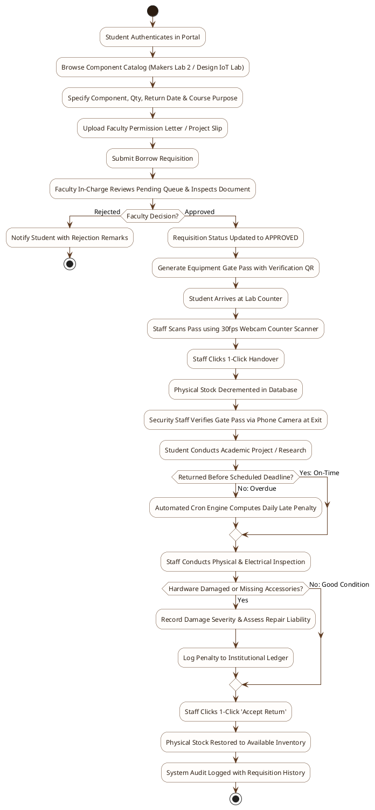
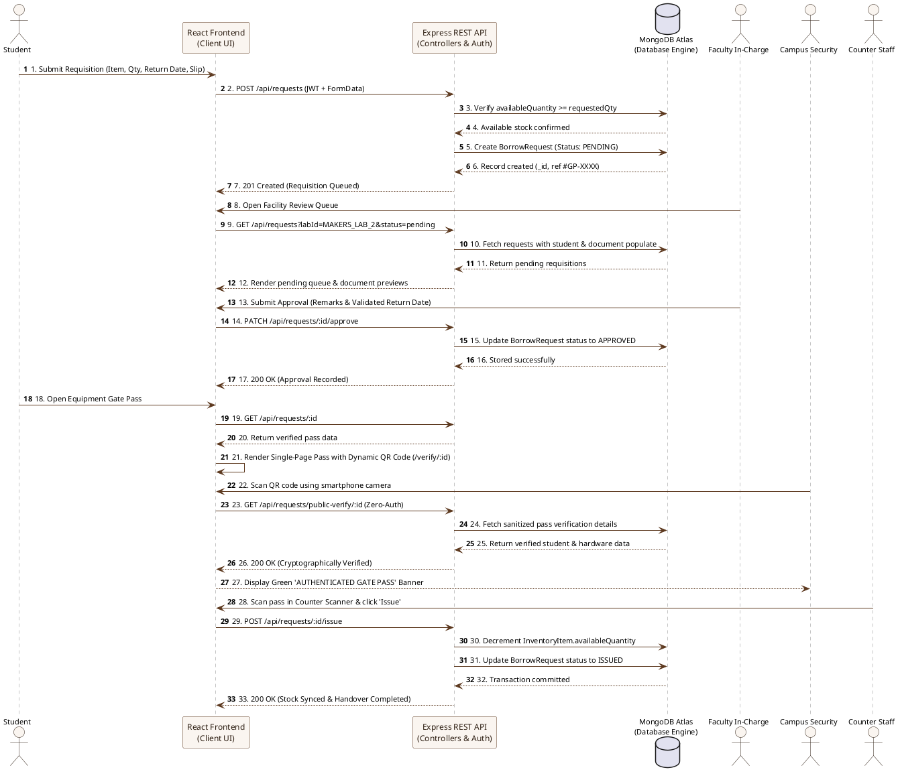
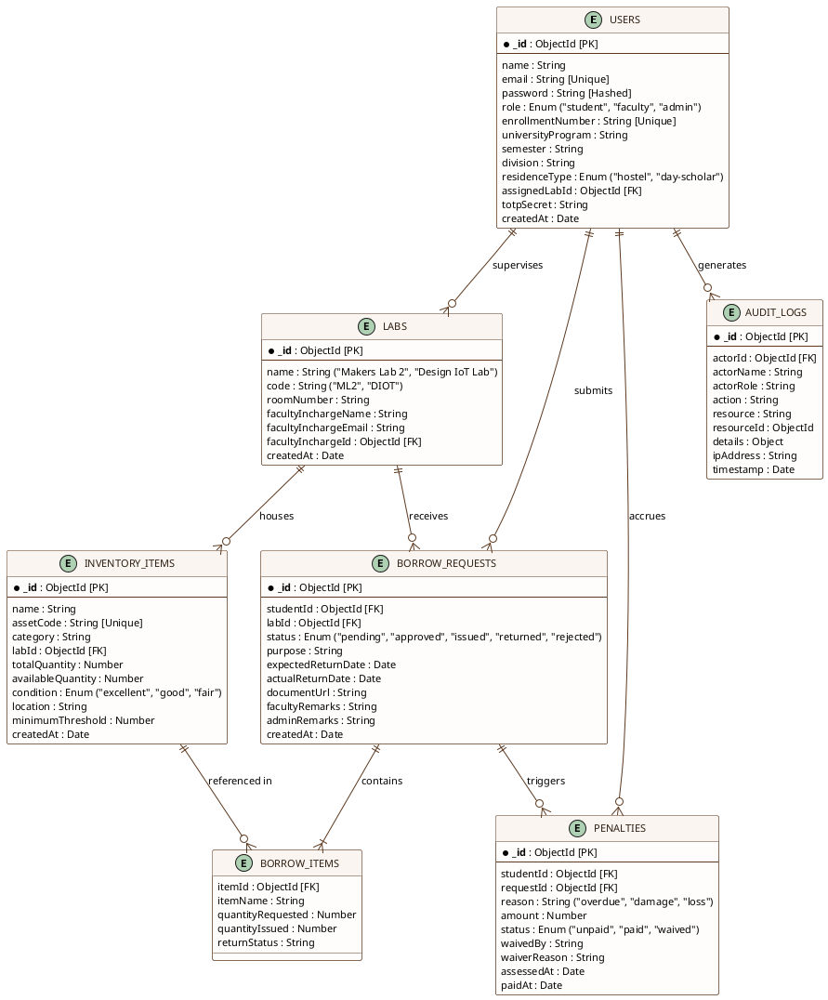

```plantuml
@startuml
skinparam handwritten false
skinparam monochrome false
skinparam packageStyle rectangle
skinparam shadowing false
skinparam backgroundColor #FFFFFF
skinparam defaultFontName "Segoe UI"
skinparam defaultFontSize 12

skinparam actor {
    BorderColor #2C1D11
    BackgroundColor #FAF5F0
}
skinparam usecase {
    BorderColor #5C381E
    BackgroundColor #FFFDFB
    ArrowColor #5C381E
}

actor "Student" as Student
actor "Faculty In-Charge" as Faculty
actor "Lab Counter Assistant" as Staff
actor "System Administrator" as Admin
actor "Campus Security" as Security

rectangle "Lab Inventory Management System\n(Makers Lab 2 & Design IoT Lab)" {
    usecase "UC1: Sign In & Student Profile" as UC1
    usecase "UC2: TOTP 2FA Authentication" as UC2
    usecase "UC3: Browse Component Catalog" as UC3
    usecase "UC4: Submit Borrow Requisition" as UC4
    usecase "UC5: Upload Permission Slips" as UC5
    usecase "UC6: Review Facility Queue" as UC6
    usecase "UC7: Approve / Reject Requisition" as UC7
    usecase "UC8: Counter Webcam Handover\n(Stock Decrement)" as UC8
    usecase "UC9: Inspect Return & Damage\n(Stock Restore)" as UC9
    usecase "UC10: Generate Printable Gate Pass" as UC10
    usecase "UC11: Verify Pass QR Code (/verify/:id)" as UC11
    usecase "UC12: Audit Penalties & Grant Waivers" as UC12
    usecase "UC13: Digital No-Dues Clearance" as UC13
}

Student --> UC1
Student --> UC3
Student --> UC4
Student --> UC5
Student --> UC10
Student --> UC13

Faculty --> UC1
Faculty --> UC6
Faculty --> UC7
Faculty --> UC8
Faculty --> UC9

Staff --> UC8
Staff --> UC9
Staff --> UC10

Admin --> UC2
Admin --> UC12
Admin --> UC8
Admin --> UC9

Security --> UC11
@enduml
```

# UML & Architecture Diagrams: Master Prompts & Generation Guide
### Lab Inventory Management System (GSFC University)

This guide provides **Master Prompts** and **Ready-to-Paste Code** to generate publication-grade, ultra-clean academic diagrams for your project report.

Once you generate your images, save them into `assets/diagrams/` with the exact filenames listed below. Then simply run `node scripts/generateDocx.js` to automatically recompile your report with the new diagrams!

---

## Quick Replacement Reference Table

| Figure | Diagram Name | Target Filepath in Project | Recommended Aspect Ratio |
| :---: | :--- | :--- | :---: |
| **Figure 1** | Use Case Diagram | `assets/diagrams/fig1_use_case.png` | 16:9 or 3:2 |
| **Figure 2** | Activity Diagram | `assets/diagrams/fig2_activity.png` | 2:3 or 3:4 (Vertical) |
| **Figure 3** | Sequence Diagram | `assets/diagrams/fig3_sequence.png` | 3:4 or 4:5 (Vertical) |
| **Figure 4** | Entity-Relationship (ER) Diagram | `assets/diagrams/fig4_er_diagram.png` | 16:9 or 4:3 |
| **Figure 5** | DFD Level – 0 (Context Level) | `assets/diagrams/fig5_dfd_level0.png` | 16:9 (Horizontal) |
| **Figure 6** | DFD Level - 1 (Decomposition) | `assets/diagrams/fig6_dfd_level1.png` | 4:3 or 1:1 |
| **Figure 7** | System Architecture Diagram | `assets/diagrams/fig7_architecture.png` | 16:9 |

---

## 1. Figure 1: Use Case Diagram
**Target File:** `assets/diagrams/fig1_use_case.png`

### 🎨 Master AI Image Prompt (ChatGPT Plus / Midjourney / DALL-E 3)
> **Prompt:**  
> A professional, high-resolution software engineering UML Use Case Diagram for a "University Lab Inventory & Hardware Clearance Management System". Crisp white background, clean vector lines, academic textbook illustration style. On the left and right sides are stick-figure actors: "Student", "Faculty In-Charge", "System Administrator", and "Campus Security Staff". Inside a large rectangular system boundary labeled "Lab Inventory Management System (Makers Lab 2 & Design IoT Lab)", display neat oval use case bubbles with clean modern typography: "User Login & Registration", "TOTP 2FA Verification", "Browse Equipment Catalog", "Submit Borrow Requisition", "Upload Permission Slips", "Faculty Approval Queue", "Handover Hardware (Stock Decrement)", "Confirm Return & Stock Restore", "Print Official Gate Pass", "Scan QR Code for Gate Verification", "Audit Overdue Penalties & Waivers", and "Automated No-Dues Clearance". Elegant connector lines connect actors to relevant use cases. Palette: Crisp white background, charcoal grey lines, subtle institutional accents (#5C381E, #2C1D11, #285420). Sharp, ultra-clean vector diagram, no blur, high contrast, 4K resolution.

### 💻 PlantUML Code (Paste at [planttext.com](https://www.planttext.com))


---

## 2. Figure 2: Activity Diagram
**Target File:** `assets/diagrams/fig2_activity.png`

### 🎨 Master AI Image Prompt (ChatGPT Plus / Midjourney / DALL-E 3)
> **Prompt:**  
> A professional, publication-quality software engineering UML Activity Diagram depicting the complete lifecycle of a university laboratory equipment borrowing and gate clearance system. Clean vertical flowchart on pure white background. Rounded activity boxes, diamond decision nodes, and solid directional arrows. Starting with black solid dot "Start: Student Portal", followed by sequential steps: "Student Signs In", "Browses Hardware Inventory (Makers Lab 2 & Design IoT Lab)", "Selects Hardware & Submits Requisition with Uploaded Project Slip". A decision diamond "Faculty Approval?": if Rejected, arrows lead to "Notify Student with Feedback" and terminates; if Approved, leads to "Student Visits Lab Counter", "Staff Scans QR Code with Webcam", "Confirm Physical Handover (Stock Decremented in Database)", "Generates Digital Gate Pass with QR", "Student Passes Campus Security Check", "Active Academic Research Period". Another decision diamond "Returned Before Deadline?": if No, branches to "Automated Overdue Penalty Engine Computes Fine"; if Yes, joins "Physical & Electrical Inspection". Next decision "Hardware Damaged?": if Yes, branches to "Log Repair Penalty"; if No, branches to "Staff Confirms Return", "Stock Restored to Available Inventory", "Audit Trail Recorded", and terminates at black encircled bullseye "End: Requisition Closed". Palette: white background, warm earth tones (#5C381E, #2C1D11), emerald green highlights for successful return paths. Ultra-sharp, perfectly legible vector layout.

### 💻 PlantUML Code (Paste at [planttext.com](https://www.planttext.com))


---

## 3. Figure 3: Sequence Diagram
**Target File:** `assets/diagrams/fig3_sequence.png`

### 🎨 Master AI Image Prompt (ChatGPT Plus / Midjourney / DALL-E 3)
> **Prompt:**  
> A detailed, clean UML Sequence Diagram showing the step-by-step interactions of a university laboratory inventory management system. Pure white background, professional technical diagram aesthetic. Across the top are vertical participant lifelines: "Student (Actor)", "React Web Client (UI)", "Express REST API (Backend)", "MongoDB Atlas (Database)", "Faculty In-Charge (Actor)", and "Campus Security (Actor)". Chronological horizontal message arrows with sequential numbers: 1. Student submits borrow form with permission slip; 2. Client sends POST /api/requests multipart/form-data; 3. API queries item availableQuantity in MongoDB; 4. Database returns stock balance; 5. API creates borrow request with status PENDING; 6. Faculty opens approval queue; 7. API queries pending requests; 8. Faculty sends PATCH /api/requests/:id/approve; 9. Database updates status to APPROVED; 10. Student opens printable gate pass; 11. Client generates QR code linking to /verify/:id; 12. Security guard scans QR with smartphone; 13. Security browser sends zero-auth GET /api/requests/public-verify/:id; 14. API returns cryptographically verified gate pass data; 15. Counter staff scans pass and calls POST /api/requests/:id/issue; 16. MongoDB atomically decrements inventory stock. Palette: Clean white background, charcoal lifelines, earth-tone boxes (#5C381E, #2C1D11), numbered circular badges. Crisp, razor-sharp vector lines.

### 💻 PlantUML Code (Paste at [planttext.com](https://www.planttext.com))


---

## 4. Figure 4: Entity-Relationship (ER) Diagram
**Target File:** `assets/diagrams/fig4_er_diagram.png`

### 🎨 Master AI Image Prompt (ChatGPT Plus / Midjourney / DALL-E 3)
> **Prompt:**  
> A clean, professional Crow's Foot Entity-Relationship (ER) diagram for a MongoDB university laboratory inventory and gate pass system. Pure white background, technical database design blueprint style. Distinct entity boxes with header titles, primary keys (PK), foreign keys (FK), and attribute datatypes: 
> 1. "USERS" (id PK, name, email, password, role, enrollmentNumber, universityProgram, semester, division, residenceType, assignedLabId FK, totpSecret, createdAt).
> 2. "LABS" (id PK, name, code, roomNumber, facultyInchargeName, facultyInchargeEmail, facultyInchargeId FK, createdAt).
> 3. "INVENTORY_ITEMS" (id PK, name, assetCode, category, labId FK, totalQuantity, availableQuantity, condition, location, minimumThreshold, createdAt).
> 4. "BORROW_REQUESTS" (id PK, studentId FK, labId FK, status, purpose, expectedReturnDate, actualReturnDate, documentUrl, facultyRemarks, adminRemarks, createdAt).
> 5. "BORROW_ITEMS" (embedded: itemId FK, itemName, quantityRequested, quantityIssued, returnStatus).
> 6. "PENALTIES" (id PK, studentId FK, requestId FK, reason, amount, status, waivedBy, waiverReason, assessedAt, paidAt).
> 7. "AUDIT_LOGS" (id PK, actorId FK, actorName, actorRole, action, resource, resourceId, details, ipAddress, timestamp).
> Neat relationship lines with standard Crow's Foot cardinality notations (1-to-many, 1-to-1). Palette: Pure white background, charcoal boundaries, earth-tone headers (#5C381E, #2C1D11). Clean vector layout, crisp typography, 4K resolution.

### 💻 PlantUML Code (Paste at [planttext.com](https://www.planttext.com))


---

## 5. Figure 5: Data Flow Diagram (DFD Level – 0: Context Level)
**Target File:** `assets/diagrams/fig5_dfd_level0.png`

### 🎨 Master AI Image Prompt (ChatGPT Plus / Midjourney / DALL-E 3)
> **Prompt:**  
> A high-level Data Flow Diagram (DFD Level 0 Context Diagram) for an institutional Lab Inventory Management System. Pure white background, clean Edward Yourdon / DeMarco notation. In the center is a single prominent circular process bubble labeled "0.0 Lab Inventory Management System". Surrounding the circle are rectangular external entity boxes: "Student", "Faculty In-Charge", "System Administrator", "Campus Security Staff", and "Lab Counter Staff". Direct, labeled data flow arrows connect each external entity to the central system:
> - Student → System: "Credentials, Requisitions, Permission Slips"
> - System → Student: "Approval Status, Printable Gate Pass, Digital No-Dues Certificate"
> - Faculty → System: "Decisions, Approval Remarks, Due Dates"
> - System → Faculty: "Pending Facility Queue, Attached Documents"
> - Staff → System: "Webcam Barcode/QR Scans, 1-Click Handover/Return, Damage Assessments"
> - System → Staff: "Stock Status Audio Chimes, Restocking Alerts"
> - Security → System: "QR Scan Link (/verify/:id)"
> - System → Security: "Live Verified Gate Pass & Institutional Seal"
> - Admin → System: "Inventory Master Edits, Role Configs, Fine Waivers"
> - System → Admin: "Audit Logs, Lab Utilization Analytics, CSV Reports"
> Palette: Crisp white background, charcoal borders, warm brown process bubble (#5C381E). Minimalist, technical, highly readable font.

---

## 6. Figure 6: Data Flow Diagram (DFD Level - 1: Functional Decomposition)
**Target File:** `assets/diagrams/fig6_dfd_level1.png`

### 🎨 Master AI Image Prompt (ChatGPT Plus / Midjourney / DALL-E 3)
> **Prompt:**  
> A detailed Level 1 Data Flow Diagram (DFD Level 1) for a university laboratory inventory and clearance system. Pure white background, structured engineering flowchart. External entities ("Student", "Faculty In-Charge", "Counter Staff", "Administrator") connect to numbered functional process bubbles and open-ended parallel-line data stores:
> - Processes: 
>   "1.0 Authentication & RBAC Engine"
>   "2.0 Inventory Catalog & Stock Availability"
>   "3.0 Requisition Processing & Document Approval"
>   "4.0 Gate Pass Issuance & Public Verification"
>   "5.0 Counter Quick Check-In / Check-Out Scanning"
>   "6.0 Penalties & Damage Assessment Engine"
>   "7.0 Automated No-Dues Clearance Auditor"
> - Data Stores: 
>   "D1: Users Store"
>   "D2: Inventory Items Store"
>   "D3: Borrow Requests Store"
>   "D4: Penalties Ledger"
>   "D5: Audit Logs Store"
> Clearly labeled bidirectional arrows show authentication tokens, stock decrement/restoration calls, document uploads, gate pass generation, and audit logging. Elegant academic blueprint aesthetic, charcoal lines, warm earth accents (#5C381E).

---

## How to Apply Your Generated Images

1. Generate or export your diagrams in your favorite AI tool (ChatGPT Plus DALL-E 3, Midjourney, Canva, Eraser.io, or PlantText.com).
2. Save each diagram into the `assets/diagrams/` folder with its matching filename:
   - `assets/diagrams/fig1_use_case.png`
   - `assets/diagrams/fig2_activity.png`
   - `assets/diagrams/fig3_sequence.png`
   - `assets/diagrams/fig4_er_diagram.png`
   - `assets/diagrams/fig5_dfd_level0.png`
   - `assets/diagrams/fig6_dfd_level1.png`
3. In your terminal, run:
   ```powershell
   node scripts/generateDocx.js
   ```
4. Done! Your Word document `Lab_Inventory_Management_System_Project_Report.docx` will instantly recompile with your custom high-resolution diagrams embedded at the exact target dimensions and figure captions.
